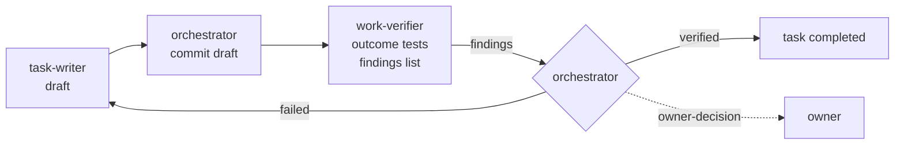

# AGENTS.md — bcachefs-freebsd

Engineering project: port of bcachefs-tools + FUSE frontend to
FreeBSD. Operational context (prod bridge, scars, measurements)
lives in the homelab repo — do not duplicate it here.

## Hard constants (council, runbook 18 §8)

- **The live pool (1.1T NVMe + 3.6T HDD, format 1.39) is never
  touched rw — not until full acceptance.** The format is
  irreversible (incompat bits since 1.36); fsck exists only on
  Linux.
- Ro-mounting the live pool is a separate risk decision, taken at
  sprint planning — never ad hoc.
- Anything new goes to a test filesystem first (vn image / test
  mount).
- D (VM+NFS) is prod; this project does not change prod before
  acceptance.

## Key links

- Decision/plan: homelab `docs/freebsd/18-bcachefs-native-research.md` (esp. §4A, appendix A, §8)
- Bridge baseline: homelab `docs/freebsd/02-poc-bcachefsbox.md`
- Port template: realchonk/fuse-ufs (fuser 0.16 + `libfuse` feature → fusefs-libs3 → mount_fusefs)
- Upstream: koverstreet/bcachefs-tools (clone in `tools/`, gitignored), fuser fork koverstreet/fuser (branch destroy-before-reply)
- Upstream BSD topics: cberner/fuser issue #29; knowledge base in pi-topics (corpus + standards, see Task pipeline below)

## Layout

- `overlay/` — patches/files on top of the tools clone (until it becomes an upstream PR)
- `bench/` — measurement scripts; comparison vs the NFS bridge (metadata is the main tax, ×10.7)
- `docs/` — engineering notes, runbook, upstream corpus (`docs/notes/upstream-corpus-2026-11-13/`)
- `tasks/` — taskmd task store (see Task pipeline below)
- `tools/` — gitignored clone of bcachefs-tools
- `.pi/agents/` — project subagent personas (in git, force-added)
- `.githooks/` — commit-msg gate

## Swarm methodology: worktree + atomic commits

**Worktree per task.** Every parallel worker runs with
`worktree: true` (native subagent creates the branch+worktree,
usually under `.pi/` — gitignored). The worker works ONLY inside
its worktree: no main-checkout touches, no checkout/reset outside
its branch. After merge the orchestrator runs
`agents.cleanup({ deleteBranch: true })`. Benefits: no shared-index
races (homelab scar), task rollback = delete the branch, task diff
= the whole branch.

**Atomic commits (mandatory).**
- One logical change = one commit; the tree must build after each
  commit (if it cannot — explicit `wip:` prefix, squash before
  merge).
- Format: Conventional Commits, subject ≤72, imperative (gate:
  `.githooks/commit-msg`). Every task commit carries git trailers:
  ```
  Refs: bcfNNN
  Agent: rustacean
  ```
- A worker does NOT consider its task done while its worktree is
  dirty (`git status --porcelain` empty) — everything committed.
- `git add` with explicit paths only; blind `git add -A` forbidden.

**Only the orchestrator merges.** Order: gate-check the branch →
`git merge --no-ff <branch> -m "merge(T09): ..."` → cleanup
worktree. `git log --first-parent main` = the task journal; plain
log = atomic history. Upstream PRs are assembled by cherry-picking
task commits from history.

## Heavy-build slot (lesson T04, 2026-11-01) — tightened after three recurrences (runs 14/16, v2-link)

Agents DO NOT BUILD AT ALL (no "sync incremental" either — the
temptation to leave a linking step recurs); gmake/cargo run ONLY by
the orchestrator, on request in an agent's report. `apply.sh` is
allowed for agents (it is not a build).

One-shot agents do not own background builds: their tasks die with
the run (proven twice — runs 14 and 16 orphaned at objects 56 and
62). Model: **the heavy-build slot belongs to the orchestrator** —
it runs gmake/cargo as background jobs of its own session (survives
turns, wakes reliably); agents make short synchronous moves only
(error analysis from a log, patch, commit) and never leave
processes behind.

## Resource discipline (the machine is OOM-fragile — HARD rule)

rctl IS available in this kernel: RACCT+RCTL enabled,
`kern.racct.enable=1`; an existing rule `user:_p2p:memoryuse:deny=8G`
belongs to someone else — never touch it. Measurements and status:
docs/notes/00a-resources.md.

### Discipline (always, regardless of limiters)
- **Heavy tasks are serialized**: at most ONE cargo build / gmake -j
  / fsck-on-image at a time. Before starting a heavy op a worker
  checks free memory and `pgrep -c 'rustc|cc|gmake'`.
- Build parallelism: `gmake -j2`, `cargo build -j 2`
  (CARGO_BUILD_JOBS=2); more only with explicit orchestrator
  approval.
- Test images ≤ 2G; heavy files in tmp/, removed after the task.
- Compilations under `nice -n 19` (or `idprio 31` if available).
- Before a heavy op: `sysctl -n vm.stats.vm.v_free_count` × pagesize
  ≥ 1GB free, otherwise wait / report to the orchestrator.
- LLM side: budgets in workflows (agentBudget/tokenBudget),
  background work async + monitored, never blocking.

### rctl limiters (confirmed by experiment 2026-11-01)
- Heavy phases run through `scripts/rlimit-run.sh <MB> <cmd>`:
  PID-scoped `memoryuse:deny`, survives exec, inherited by
  children, gone when the process tree dies.
- Baseline: builds capped at 2–3 GB (cargo/gmake), fsck on image —
  1 GB. deny beats log: it protects a machine with no swap (OOM
  kills random victims).

## Worklog in git: commits = the journal

No separate journal files — git IS the worklog (template: homelab §6).
- An atomic commit = a journal entry: subject = what, body = why.
  The task status is edited by the same work commit; the
  `Refs: bcfNNN` trailer links the entry to the task (ids exist
  since the org→taskmd migration, 2026-11-13). Task history:
  `git log --grep 'Refs: bcfNNN'`.
- Ops journal — progress without a file diff (service restarts,
  mounts/pool bounces, boot tests, kernel deploys):
  `git commit --allow-empty -m "ops(area): what happened"` with
  body trailers `Context:` (why, 1 line) · `Rollback:` (1 line) ·
  `Refs: bcfNNN`. History: `git log --grep '^ops('`. Ops commits are
  records: never squash/drop/"fix" empty commits.
- Gate `.githooks/commit-msg` (R1–R8): subject form, scope
  whitelist from `.taskmd.yaml`, empty-diff⇔ops pairing,
  Refs/Context/Rollback on ops, secret scan. Wire at session start:
  `git config core.hooksPath .githooks`. `--no-verify` for new work
  — never; the only exception is a mechanical `--amend` of an
  already-validated commit.

## Task pipeline (taskmd)

Store: `tasks/` (26 tasks, ids bcfNNN, task files in English).
Spawn helpers (async:true — foreground children do not load the
toolset):



- `task-writer` (`.pi/agents/`) drafts new/restructured tasks:
  EN, one testable deliverable, OUTCOME-level ACs (an AC must FAIL
  if the deliverable is bad; canon:
  https://driangle.github.io/taskmd/guide/best-practices.html#writing-good-tasks).
- `work-verifier` (`.pi/agents/`) outcome-tests every AC and
  returns a findings LIST (verified / failed / untestable). It does
  not decide — the orchestrator closes or loops the task.
- Owner-decision tasks (GO/NO-GO, publications, prod changes) skip
  the verifier and escalate to the owner.
- Post-run falsifier: `git status --porcelain tasks/` must be empty.

## Personas

Project-local (`.pi/agents/`, in git): `task-writer`,
`work-verifier`. Universal by doctrine — domain expertise enters
through task context, not through narrow personas. User-level
(~/.pi/agent/agents/): researcher / skeptic / script-kiddie etc.
are generic; the owner is pruning narrow ones.

## Structured-text convention (AGENTS.md, persona prompts, SKILL.md)

- Sections are an OPEN set with stable vocabulary: invariants /
  live truth / recipes / workflows / pointers.
- A mermaid diagram where it beats a paragraph.
- Inline the MUST-KNOW (agents do not study pointers); pointers
  only for optional depth.
- Cross-refs are plain text: "(see <section>)".
- AC canon: https://driangle.github.io/taskmd/guide/best-practices.html#writing-good-tasks

## Rules

- Conventional Commits; separate atomic patches for future PRs
  (methodology above).
- Every deviation from the fuse-ufs template is documented in docs/
  with the reason.
- Host Rust 1.98 (needs ≥1.85) — fine.
